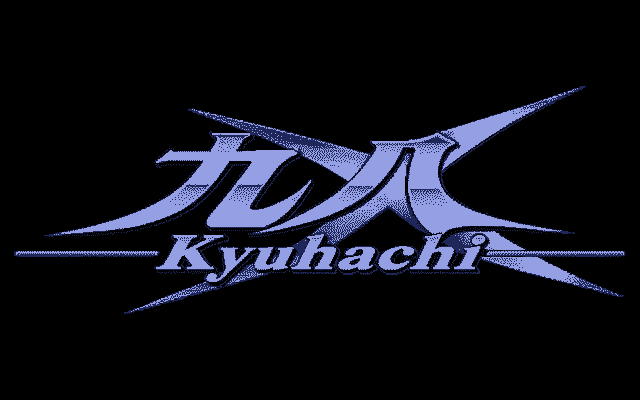

# 九八 · 큐하치 X (Kyuhachi X)

### 윈도우·안드로이드용 PC-98 게임 런처

**게임을 고르고 바로 시작.** 설정 파일도, 매퍼 메뉴도 없습니다.

[English](README.md) · 한국어

**[⬇ v0.6.5 내려받기 (윈도 zip · 안드로이드 APK · 설명서)](https://github.com/ataho99/kyuhachi-x/releases/latest)**

---

## 소개

큐하치 X 는 DOSBox-X 의 PC-98 코어에서 PC-98 게임에 필요한 것만 남기고, 게임 목록·작품별 프로필·세이브 스테이트·패드 중심 UI 로 감싼 콘솔 같은 프런트엔드입니다.

**게임 이미지·NEC 바이오스·폰트 롬은 들어 있지 않습니다.** 게임은 직접 준비해 넣으세요(아래 [라이선스·고지](#라이선스고지) 참고).

## 지원 기기

| 기기 | 비고 |
|---|---|
| 윈도우 10 / 11 (x64) | `KyuhachiX.exe`, 폴더 하나로 동작하는 포터블. 레지스트리에 쓰지 않음 |
| 안드로이드 | `KyuhachiX-v0.6.5-android.apk` (패키지 `io.github.ataho99.kyuhachix`). 레트로이드 포켓 노바에 맞춰 다듬었고 다른 패드 기기에서도 동작 |

## 설치

**윈도우**

1. 원하는 곳에 압축을 풉니다(한글·일본어 경로 가능).
2. 게임 디스크 이미지를 `KyuhachiX.exe` 옆 `KyuhachiX\games` 에 넣습니다(작품마다 폴더 하나).
3. `KyuhachiX.exe` 를 실행합니다.

옛 *큐하치*(v0.5.x)에서 올리는 경우: 처음 실행할 때 세이브가 새 `saves` 폴더로 한 번 복사되고, 옛 폴더는 그대로 남습니다.

**안드로이드**

1. APK 를 설치합니다(출처 허용 필요).
2. 공유 저장소의 `Kyuhachi/games`(`/storage/emulated/0/Kyuhachi`)에 게임을 넣습니다. 세이브도 같은 공유 폴더에 쌓입니다.
3. *Kyuhachi X* 를 실행합니다.

## 주요 기능 (v0.6.0)

- **작품별 프로필** — 부팅 방식·키·자동 입력을 작품마다 저장해 그냥 켜집니다.
- **자동 실행** — D88·FAT12 디스크 이미지를 읽어 실제 게임 실행 파일을 고르고, 도구류는 건너뛰며, 압축 디스크도 풉니다. 저절로 안 뜨는 작품은 화면에서 한 번 정해 두면 기억합니다.
- **세이브 스테이트** — 빠른 저장·불러오기와 슬롯. 윈도우판은 v0.5.x 세이브를 자동으로 옮깁니다.
- **패드 우선** — 일본식 결정·취소 배치가 기본이고 자유롭게 바꿀 수 있습니다. 도움말 화면은 노바 버튼을 위치+이름으로 표기합니다.
- **픽셀 그대로** — 정수 배율, 화면 비율, 선택형 CRT 셰이더. 창/전체화면을 그 자리에서 전환합니다.
- **한글 대응** — 한글패치용으로 Neodgm 기반 내장 글꼴. 메뉴는 영·일·한(`strings_en.txt`, `strings_ja.txt`, `strings_ko.txt`)이며 메모장으로 고칠 수 있습니다.
- **리듬 음원** — `res/rhythm/` 에 YM2608 리듬 WAV 를 넣으면 드럼이 납니다(저작권상 동봉하지 않음).

안드로이드 사용법은 [`docs/manual/안드로이드_사용설명서.md`](docs/manual/안드로이드_사용설명서.md) 를 보세요(릴리스 페이지의 `KyuhachiX-v0.6.0-manual-ko.zip` 에도 있음).

## 조작

패드 버튼과 핫키는 **설정 → 조작**에서 전부 바꿀 수 있습니다. 기본값(패드 표기 = 레트로이드 포켓 노바, retro 배치):

| 키보드 | 패드 | 기능 |
|---|---|---|
| `Space` / `Esc` | `A` / `B` | 결정 / 취소 |
| `Enter` | `START` | Enter |
| 방향키 | 십자키 / 왼쪽 스틱 | 방향키 |
| `CAPS` | `Y` | 빨리 넘김 |
| `F12` | `X`, `SELECT+START` | 메뉴 |
| `F11` 누르는 동안 / `ScrollLock` | `R2` 누르는 동안 / `L3` | 배속 / 배속 켜고 끄기 |
| `Alt+F5` / `Alt+F9` | `SELECT+R1` / `SELECT+L1` | 퀵 저장 / 퀵 불러오기 |
| `Alt+K` | `SELECT+X` | 화면 키보드 |
| — | `SELECT+R3` | 스크린샷 |
| — | `SELECT+R2` | 다음 디스크로 교체 |
| `Alt+Enter` | — | 전체화면 |
| `Alt+1` `2` `3` | — | 화면 비율 |
| `Alt+S` / `Alt+↑` `↓` | — | 셰이더 / 곡면 세기 |
| `Alt+[` `]` | — | 창 배율 |
| `Alt+F` | — | FPS 표시 |
| `Alt+M` / `Alt+P` | — | 마우스 가두기 / 자동 입력 재개 |

## 소스에서 빌드

DOSBox-X 소스를 뺀 모든 것이 이 저장소에 있고, DOSBox-X 는 `third_party/DOSBOX_X.lock` 에 고정된 리비전을 씁니다.

1. 고정 리비전의 DOSBox-X 를 받아 `tools/apply_core_patches.sh` 로 `core_patches/` 를 적용합니다(추가 코어 파일은 `core_added/`).
2. 윈도우: `cmake/build.sh` 실행(CMake, `CMakeLists.txt` 참고).
3. 안드로이드: `android/` 의 소스를 NDK 로 빌드합니다.
4. `tools/t11.sh` 가 구조 검사(줄 길이·리터럴·의존)를 돌립니다.

`docs/BUILD.md` 는 옛 초안이며 위 스크립트가 기준입니다.

## 라이선스·고지

큐하치 X 는 DOSBox-X 일부를 포함하므로 **GNU GPL v2** 로 배포됩니다([`LICENSE`](LICENSE)). SDL·zlib·libpng·Neodgm·Shinonome·SDL_GameControllerDB·셰이더 등 외부 구성요소와 라이선스는 [`NOTICE.md`](NOTICE.md) 에 있습니다.

**포함하지 않고, 커밋하지도 않는 것:** 게임 이미지(`.d88 .hdi .fdi .nfd .hdm` 등), NEC 바이오스·폰트 롬, FREECG98, 게임 원본 글꼴, YM2608 리듬 음원. 가지고 있는 소프트웨어만 쓰세요.

## 100% AI 코딩

이 저장소의 코드는 전부 AI 에이전트(Anthropic Claude — Claude Code)가 썼고, 사람(프로젝트 주인)은 방향을 정하고 판단했습니다.

## 크레딧

[DOSBox-X](https://github.com/joncampbell123/dosbox-x) 위에 만들었습니다. 개발자분들께 감사드립니다.
