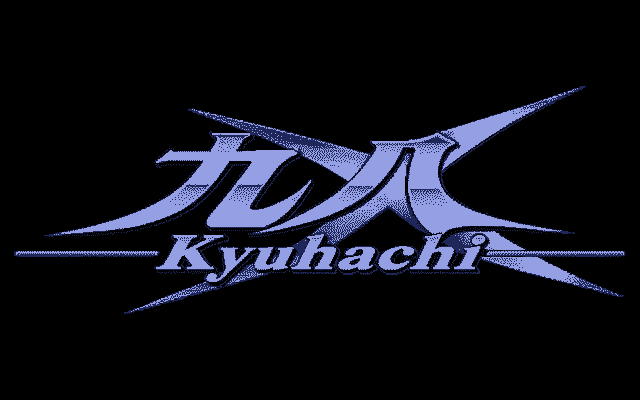

# 九八 · Kyuhachi X

### A PC-98 game launcher for Windows and Android

**Pick a game. Play.** No config files, no mapper menus.

English · [한국어](README.ko.md)

**[⬇ Download v0.6.0 (Windows zip · Android APK · manual)](https://github.com/ataho99/kyuhachi-x/releases/latest)**

**[⬇ Download v0.6.0 (Windows zip · Android APK · manual)](https://github.com/ataho99/kyuhachi-x/releases/latest)**

---

## What it is

Kyuhachi X takes the DOSBox-X PC-98 core, cuts it down to what PC-98 games need, and wraps it in a console-like front end: a game list, per-game profiles, save states and a gamepad-first UI.

**Kyuhachi X ships no game images, no NEC BIOS and no font ROMs.** You bring your own games (see [Notices](#license--notices)).

## Supported devices

| Device | Notes |
|---|---|
| Windows 10 / 11 (x64) | `KyuhachiX.exe`, portable folder, nothing written to the registry |
| Android | `KyuhachiX-v0.6.0-android.apk` (package `io.github.ataho99.kyuhachix`); tuned for the Retroid Pocket Nova, works with other gamepad devices |

## Install

**Windows**

1. Unzip the package anywhere (Korean/Japanese paths are fine).
2. Put your game disk images in `KyuhachiX\games` next to `KyuhachiX.exe` (one folder per game).
3. Run `KyuhachiX.exe`.

Upgrading from the old *Kyuhachi* (v0.5.x): on first run your saves are copied to the new `saves` folder once; the old folder is left untouched.

**Android**

1. Install the APK (allow installs from this source).
2. Put games under `Kyuhachi/games` in shared storage (`/storage/emulated/0/Kyuhachi`); saves are kept in the same shared folder.
3. Start *Kyuhachi X*.

## Main features (v0.6.0)

- **Per-game profiles** — boot method, keys and auto input are stored per game, so titles just start.
- **Auto launch** — reads D88 / FAT12 disk images and picks the real game executable, skips tools, handles self-extracting disks. Titles that do not start by themselves can be set once in the UI and are remembered.
- **Save states** — quick save / load and slots; the Windows build migrates v0.5.x saves automatically.
- **Gamepad first** — Japanese-style confirm / cancel, fully remappable; Nova buttons are labelled by position and name in the help screen.
- **Pixel-perfect display** — integer scaling, aspect modes, optional CRT shader; window / fullscreen switching in place.
- **Hangul-ready** — built-in font derived from Neodgm for Korean fan translations; menus in English, Japanese and Korean (`strings_en.txt`, `strings_ja.txt`, `strings_ko.txt` — edit them in any text editor).
- **Rhythm samples** — optional YM2608 rhythm WAVs in `res/rhythm/` (not bundled).

Android usage is covered in [`docs/안드로이드_사용설명서.md`](docs/안드로이드_사용설명서.md) (Korean; also as `KyuhachiX-v0.6.0-manual-ko.zip` on the Releases page).

## Build from source

Everything needed is in this repository except the DOSBox-X sources, which are pinned in `third_party/DOSBOX_X.lock`.

1. Fetch DOSBox-X at the pinned revision and apply `core_patches/` with `tools/apply_core_patches.sh` (extra core files are in `core_added/`).
2. Windows: run `cmake/build.sh` (CMake, see `CMakeLists.txt`).
3. Android: sources in `android/` (the same host code, built through the NDK).
4. `tools/t11.sh` runs the structural checks (line length, literals, dependencies).

`docs/BUILD.md` is an older draft; the scripts above are authoritative.

## License / Notices

Kyuhachi X is distributed under the **GNU GPL v2** (see [`LICENSE`](LICENSE)), as it contains parts of DOSBox-X. Third-party components (SDL, zlib, libpng, Neodgm, Shinonome, SDL_GameControllerDB, shader) and their licenses are listed in [`NOTICE.md`](NOTICE.md).

**Not included, and never committed:** game images (`.d88 .hdi .fdi .nfd .hdm` …), NEC BIOS / font ROMs, FREECG98, original game fonts, the YM2608 rhythm samples. Please use only software you own.

## 100% AI-coded

Every line of code here was written by AI agents (Anthropic Claude — Claude Code); the project owner set the direction and made every call.

## Credits

Built on [DOSBox-X](https://github.com/joncampbell123/dosbox-x) — thanks to its developers.
