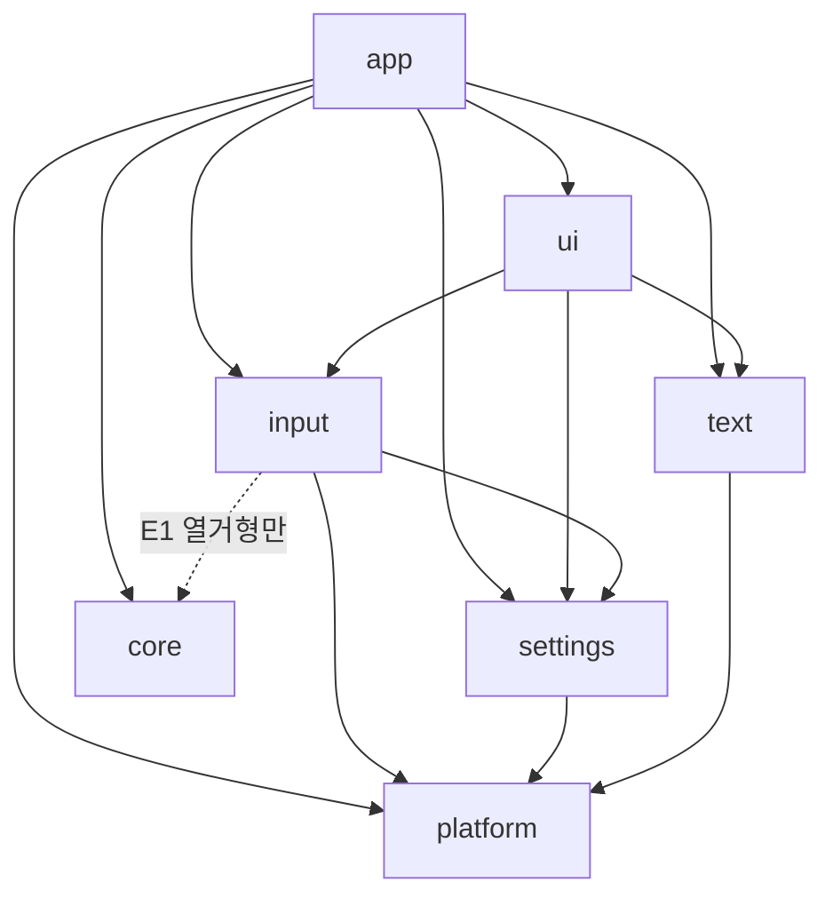

# 큐하치 모듈 전환 설계 v1.1 (module_plan_v1_1)

v1.1 = v1 + 판정 #1518 △ 5건 + S0 실측 반영(부록 C). 본문 번호·표는 v1 과 같다.

지시 #137 → v0, 지시 #141 → v1 (판정 #1515 △ 9건 · 판정 #1516 · 지시 #140 ①② · 지시 #142 반영) · 기준 소스 work\t52i (build 60, 0.5.0-t52i, exe sha 04925613…13c0). v1 은 설계 문서이며 이 문서 자체로는 소스·빌드를 바꾸지 않는다. 슨상 결정 D1~D7 은 전부 「예」(§8-2).
목표: 구조만 바꾸고 기능은 그대로. 동작 기준 = t52i. 근거 문서: ui_restructure_v0.md · android_survey_20261103.md · ui_map_t52d.md.
수치 출처 표기: [실측] = work\t137\measure_out.txt 와 후속 grep(같은 소스). [추정] = 근거 있는 추정. [미측정] = 단계 S0 에서 측정.

---

## 0. 한눈에

| 항목 | 값 |
|---|---|
| 우리 소스 | 약 8,670 줄 / 19개 파일 [실측] |
| 가장 큰 파일 | host 3,530 줄 · ui 1,665 줄 (합 60%) [실측] |
| 전역변수 | host 144 + ov 12 + kbov 17 + prof 4 = 177 [실측] |
| 포장 안 된 한글 리터럴 | 328개 / 약 237줄 [실측, 로그 문구 포함] |
| 플랫폼 코드 | host 에 #if 16 · WinAPI 56 호출, ov 에 4·2, ui 에 1 [실측] |
| git | 없음 (git·cmake·gcc 는 WSL 에 있음) [실측] |
| 빌드 폴더 | work 97개 · 소스 사본 약 102 MB · out_ 110 · test_ 292 [실측] |
| 목표 모듈 | core · app · ui · settings · input · text · platform (7개) |
| 단계 | 14단계(S0·SF·S1~S4·FK·S5~S11), 빌드 16회 (S8 은 3회) — v0 의 12단계/14빌드에 SF·FK 두 개 추가 |

---

## 0-A. v1 에서 바뀐 것과 고정 조건

### 0-A-1. 판정 #1515 △ 9건 처리

| △ | 지적 | v1 처리 | 위치 |
|---|---|---|---|
| 1 | R-4(문구 전부 T) ↔ R-9(키 추가 금지) | R-9 에 예외: 키 추가는 **S4 와 기능 변경 빌드(§3-A)에서만**, 3개 언어 동시·삭제 금지·`check_keys` 0/0. 구조 빌드(S1~S3·S5~S11)는 키 불변 | §3 R-4·R-9 |
| 2 | settings 가 text 금지인데 사용자 문구 필요 | 새 규칙 R-11: settings·input 은 문구를 만들지 않고 **메시지 코드(enum)** 를 돌려준다. `T()` 는 ui(또는 app)가 한다 | §3 R-11 |
| 3 | R-4 로그 영어 ↔ D6 한국어 | **D6 로 통일: 로그 문구는 한국어 그대로.** R-4 에서 「영어/키워드」 삭제 | §3 R-4 |
| 4 | T1 이 모든 화면 윗줄 버전 문구에서 불합격 | 비교에서 **모든 화면** 맨 윗줄 빌드 문구 영역을 가림(S_ABOUT 한정 삭제). 가림 좌표는 S0 에서 golden 과 함께 고정 | §5-3 T1 |
| 5 | MSVC 먼저 ↔ 안드로이드 조사 문서(MinGW 먼저) | D3 승인(MSVC 먼저, 안드로이드용은 S10). 갈림 사실과 이유를 §5-2 에 명시, S10 에서 재검토 | §5-2 |
| 6 | D7 새 기능 금지로 급한 변경이 막힘 | 급한 통로(§3-A) | §3-A |
| 7 | D2 「8단계 뒤」 ↔ §7-1 「S8c 뒤」 | 한 표현으로: **S0~S8c(SF·FK 포함 13빌드, FK 제외 12) 끝난 뒤** | §7-1·§8 |
| 8 | 측정 한계 | §1 머리에 한계를 묶어 적고, 독립 재측정 절차(`tools/measure.sh`)를 S0 산출로 추가 | §1·S0 |
| 9 | 팀장방이 재측정 안 함 | 같음 — 모든 수치에 명령을 붙여 재실행 가능하게 한다(S0) | S0·부록 A |

### 0-A-2. 고정 조건 C-1 (지시 #140 ①)

- 롤백(새 버전에서 만든 파일을 옛 버전이 읽기)은 고려하지 않는다.
- 단, **새 버전은 기존 파일을 계속 읽는다**: ① `settings.ini` ② 작품별 설정(`game.ini`·`user.ini`) ③ 게임 DB(`gamedb.ini`, `gamedb_nk.tsv`, `sha_cache.tsv`) ④ 세이브(`saves\<작품>\slot0N.g98s`, 디스크 사본 `disk\`). 키 이름·값 범위·파일 형식을 바꾸지 않는다. 새 키는 추가만 가능하고, 없으면 기본값.
- 위반 검사: T7(ini diff 0) + T12(세이브 불러오기) + T13(설정·DB 호환). 하나라도 불합격이면 그 단계 STOP.
- 알려진 충돌: **세이브는 지금 빌드 ID 가 한 글자만 달라도 거부**한다(state_audit_v1 원인 1). 구조 빌드마다 빌드 이름이 바뀌므로 SF 없이는 C-1 을 지킬 수 없다 → SF 를 S0 바로 다음에 둔다(§6).

### 0-A-3. 지시 #140 ② 결과의 반영
- 상태 파일 불러오기 호환(F1)과 크래시 방지(F2)와 덮어쓰기 보호(F5)를 **한 빌드(SF)** 로 묶는다 (판정 #1516 △2).
- 실패 이유 문구(F4)·목록 호환 표시(F3)·상태 로그(F6)는 새 문구·새 파일이 필요하므로 별도 기능 변경 빌드 FK (판정 #1516 △4).

---

## ① 현재 상태 측정

측정 한계(공개): ① 호출 관계는 접두 사용 횟수이지 함수 단위 그래프가 아님 ② 전역 177개의 모듈 귀속 전수표 없음(U6) ③ mixer·paging 수정 줄 수 미측정(U9), diff 줄 수는 상한 ④ DOSBox-X 원본 버전 미기록(U1) ⑤ 이 수치들은 큐하치방 자체 측정이며 팀장방이 독립 재측정한 값이 아님 → S0 에서 모든 측정 명령을 `tools/measure.sh` 한 파일로 저장해 누구나 재실행·대조할 수 있게 한다.

### 1-1. 파일별 줄 수 (work\t52i 기준)

| 파일 | 줄 | 바이트 | g_ 전역 | 함수(줄머리) | #if | WinAPI | 하는 일 |
|---|---:|---:|---:|---:|---:|---:|---|
| gensei_host_v12_t39ui.cpp | 3,530 | 338,931 | 144 | 206 | 16 | 56 | 창·GL·메인루프·설정 적용·프로필·리듬·전체화면·시험 하니스(uitest/uikeys) 전부 |
| gensei_ui_t39.h | 1,665 | 171,341 | 0 | 8(+struct Ui 안 메서드) | 1 | 0 | 화면 33개의 그리기·키 처리·이동(`struct Ui`), 설정 구조체 |
| gensei_prof_t39.h | 866 | 80,318 | 4 | 57 | 0 | 0 | 디스크 이미지 판독·FAT 목록·작품 프로필·게임DB·진입 정보 |
| gensei_ov_t39.h | 524 | 36,177 | 12 | 47 | 4 | 2 | 캔버스·글꼴(BMP/자모 조합)·도움말 키 표 |
| gensei_addwork_t40.h | 467 | 40,447 | – | – | – | – | 작품 추가 작업 (`aw::`) |
| gensei_input12_t48e.h | 282 | 21,316 | 0 | 21 | 0 | 0 | 패드·키 바인딩 |
| gensei_kbov_t52f.h | 225 | 15,921 | 17 | 35 | – | – | 화면 키보드 오버레이 |
| gensei_hangul_t48.h | 200 | 14,027 | – | – | – | – | 한글 조합 |
| gensei_nkdb.h / gensei_zip.h | 168 / 168 | 12,717 / 11,249 | – | – | – | – | 게임DB 내장 / zip 판독 |
| gensei_boostaud.h (+boostmix.inc) | 148 (+31) | 8,359 (+2,114) | – | – | – | – | 배속 소리 |
| gensei_ent_t39.h | 117 | 9,886 | 0 | 15 | 0 | 0 | 진입 템플릿·단계·점검 (`ent::`) |
| gensei_phrase_t52.h | 100 | 8,446 | – | – | – | – | 문구 `phr_()`, CRITICAL_SECTION 사용(Windows 전용) |
| gensei_kbtable_t46.h | 67 | 7,012 | – | – | – | – | 키 표 |
| gensei_uilist_t39.h | 55 | 4,541 | 0 | 6 | 0 | 0 | 목록 보조 (`ulist::`) |
| gensei_fontreg_t39.h | 36 | 3,329 | – | – | – | – | 글꼴 등록 |
| kh_version.h | 12 | 486 | – | – | – | – | 버전 |
| gensei_harness_t49a.h | 8 | 1,198 | – | – | – | – | 시험 하니스 |
| 합계 | 약 8,670 | | 177 | | | | |

비고: ui.h 는 줄당 평균 약 103 자 [실측 171,341 B / 1,665 줄]. 줄 수보다 바이트로 큰 파일이다.
host 의 큰 함수 [실측 awk 근사]: `main` 455 줄 · `GFX_Events` 196 줄 · `gh_uitest` 179 줄 · `VM_Boot_DOSBox_Kernel` 91 줄 · `gh_ui_init_games` 88 줄.

### 1-2. 화면 목록 (`enum Scr`, 33개) [실측]

S_MAIN S_PICK S_SCREEN S_CONF S_SAVE S_EXTRA S_QUIT S_GAME S_KEYS S_HELP S_START S_SWAP S_SWAPI S_ABOUT S_ADD S_SORT S_ENT S_ENTMENU S_TPL S_EDIT S_FILE S_KEYSEQ S_STEP S_SWAPED S_FONT S_OSK S_NAME S_YN S_HDDASK S_LANG S_VALS S_PAD S_PADKEY.
`d_*` 그리기 함수 34개. 시험 캡처 파일명에 화면 번호(s##)가 들어가므로 열거 값은 **UI 개편 전까지 고정**한다(규칙 R-8).

### 1-3. 누가 무엇을 쓰나 (호출 관계표) [실측: 접두 사용 횟수]

행 = 쓰는 쪽, 열 = 쓰이는 쪽. 숫자 = 소스 안 사용 횟수.

| 쓰는 쪽 \ 쓰이는 쪽 | ui:: | ov:: | prof:: | ent:: | kbov:: | aw:: | hg:: | phr_ | gh_(host 안) |
|---|---:|---:|---:|---:|---:|---:|---:|---:|---:|
| host.cpp | 279 | 157 | 76 | 4 | 64 | 134 | 2 | 148 | 921 |
| ui.h | – | 6 | 0 | 56 | 0 | 0 | 8 | 691 | – |
| ov.h | 0 | – | 0 | 0 | 0 | 0 | 0 | 14 | – |
| uilist.h | 12 | 0 | 7 | 0 | 0 | 0 | 0 | 5 | – |
| kbov.h | 0 | 4 | 0 | 0 | 1 | 0 | 0 | 0 | – |
| prof.h · ent.h · input12.h | 0 | 0 | 0 | 0 | 0 | 0 | 0 | 0 | – |

읽는 법:
- ui.h 는 host 를 직접 부르지 않는다. `struct Env`(호스트가 채우는 입출력)와 `Act`(반환 동작)로만 통한다. 이미 좋은 경계다.
- host.cpp 가 모든 곳을 부른다(허브). 분리의 핵심은 host.cpp.
- prof·ent·input12 는 다른 우리 코드를 쓰지 않는다. 바닥 모듈이 될 수 있다.
- ui.h 안 `phr_` 691 회 = 화면 문구는 이미 대부분 포장됨(ui 안 포장 안 된 한글은 24개).
- include 관계 [실측]: ui.h → kh_version · ov · ent · fontreg · hangul. ov → phrase. uilist → ui · prof. input12 → keyboard.h(DOSBox-X) · mouse.h · kbtable. kbov → kbtable. host → DOSBox-X 헤더 약 25개 + 우리 헤더 전부.

### 1-4. 포장 안 된 한글 리터럴 [실측: 주석 제외, phr_( 바로 뒤가 아닌 것]

| 파일 | 개수 | 줄 |
|---|---:|---:|
| host.cpp | 227 | 161 |
| prof.h | 52 | 40 |
| ui.h | 24 | 17 |
| input12.h | 10 | 10 |
| kbov.h | 9 | 7 |
| ov.h | 6 | 2 |
| 합계 | 328 | 237 |

지시서의 「약 150」과 다르다. 차이 원인 = 로그·진단 문구(`gh_log` 등)가 섞여 있음. 사용자에게 보이는 것과 로그를 가르는 일은 S4 의 첫 작업(결정 D6).

### 1-5. 플랫폼 의존 위치 [실측]

| 위치 | 내용 |
|---|---|
| host.cpp `#if defined(WIN32)` 45·2851·2945·3202행 | 창·파일·프로세스 |
| host.cpp `GH_DOSKERNEL` 6곳 | 빌드 변형 스위치 (플랫폼 아님, 정리 대상) |
| host.cpp WinAPI 호출 | CreateDirectoryA 19 · GetFileAttributesA 9 · DeleteFileA 8 · GetModuleFileNameA 5 · MultiByteToWideChar 4 · FindFirstFileA 4 · CreateProcessA 4 · DwmSetWindowAttribute 3 · MessageBoxW 2 · WideCharToMultiByte 2 · Sleep · SetWindowPos · MoveFileA · FindWindowA 각 1 |
| ov.h | WideCharToMultiByte 2 |
| phrase.h | CRITICAL_SECTION (Windows 전용 잠금) |
| 창·GL | SDL_CreateWindow·GL 컨텍스트·셰이더(`GProg`)는 host 3249행 부근. Android 는 GLES 로 달라질 수 있음 (미확인 U3) |

### 1-6. 우리가 고친 DOSBox-X 원본 파일 [실측: .diff 줄 수 = 머리·문맥 포함 총 줄, 변경 줄 수의 상한]

| 원본 파일 | 우리 사본 | 사본 줄 | diff 줄(상한) | 반영 방식 |
|---|---|---:|---:|---|
| bios.cpp | save_src\B\bios.cpp.B | 13,456 | 33 | 통째 사본 + patch_bios.pl(25줄) |
| keyboard.cpp | save_src\B\keyboard.cpp.B | 3,180 | 141 | 통째 사본 |
| floppy.cpp | save_src\D1\floppy.cpp.D1 | 1,735 | 110 | 통째 사본 |
| pic.cpp | save_src\FE\pic.cpp.E | 1,543 | 81 | 통째 사본 |
| pc98_lio.cpp | save_src\B\pc98_lio.cpp.B | 1,720 | 37 | 통째 사본 |
| dma.cpp | save_src\B\dma.cpp.B | 993 | 21 | 통째 사본 |
| mixer.cpp | ref\mixer.cpp.orig + patch_mixer_t35.pl | 1,373 | [미측정] (패치 스크립트 16줄) | 원본 + perl 패치 |
| paging.cpp | r011 의 s11_paging | 1,564 (.orig) | [미측정] | 미리 빌드한 obj |
| 추가 파일(원본 없음) | pc98_savestate_v3.cpp 282 · pc98_fm_state_v3.cpp 156 · vga_pc98_state.cpp 228 · pc98_sys_state.cpp 125 · pc98_fdc_state.cpp 47 · pc98_savestate_v3.h 28 | 866 | – | 새 파일 |
| 빌드 방식 | s9_* 11개(pic video sys kbd dma lio fm floppy fdc fmtimer pcm86io) · s11_paging · s17_* 3개 · gensei_menu.obj · ana\src\obj 의 SDL2 Release obj 다수를 **미리 빌드한 obj 로 링크** | | | |

핵심 문제 3개 [실측 + 빌드 스크립트 구조]:
1. 13,456 줄짜리 bios.cpp 를 통째로 복사해 두고 33 줄 남짓 바꾼다. 원본이 어느 버전인지 기록이 없다 (U1).
2. 원본 파일 목록이 폴더(A B C D1 FE ref)와 빌드 스크립트 안에 흩어져 있다.
3. 빌드마다 work\<tag>\ 폴더에 소스를 통째 복사하고 perl `rep()` 패치(개수 검사)로 고친다. work 97개 · 102 MB.

---

## ② 목표 모듈과 경계

### 2-1. 모듈 표

| 모듈 | 한 줄 역할 | 지금 들어갈 것 (출처) |
|---|---|---|
| core | DOSBox-X PC-98 본체. 우리 수정은 최소·목록화 | DOSBox-X 원본, §1-6 의 수정·추가 파일, `GameLink`(host 1163행) |
| app | 시작·메인 루프·상태 전환·모듈 연결 | host.cpp 의 main·GFX_Events·gh_ui_main·gh_apply_*·gh_state_*·GL 출력·리듬 찾기·시험 하니스 |
| ui | 화면 한 장 = 파일 하나 + 공통 그리기·위젯 | ui.h 전부, ov 의 Canvas·도움말 키 표, uilist, kbov 의 그리기 |
| settings | 전역·작품별 설정, 게임DB, 파일 형식 | `ui::Settings`, prof.h, ent.h, nkdb, zip, addwork, settings.ini·game.ini·user.ini·gamedb.ini 읽기/쓰기 |
| input | 키보드·패드·터치·오버레이 버튼·키 매핑 | input12, kbtable, kbov 의 논리, `ui::UKey`, GKey/GInj(입력 주입), host 의 gh_kb_* |
| text | 언어 파일·글꼴 그리기 | phrase.h, strings_ko/en/ja.txt 읽기, ov 의 FontX·BmpFont·jm·Comp·Sym, hangul, fontreg |
| platform | 경로·권한·로그·창·시계·프로세스. Windows/Android 차이는 여기만 | host 의 WinAPI 56곳, CRITICAL_SECTION, ov 의 WideChar 변환, 로그 `gh_log`, 시계 |

### 2-2. 공개 인터페이스 (헤더에 내놓는 것)

| 모듈 | 공개 헤더 (include/<모듈>/) | 내놓는 함수·타입 |
|---|---|---|
| platform | plat_paths.h · plat_log.h · plat_window.h · plat_clock.h · plat_proc.h · plat_utf.h · plat_lock.h | `exe_dir() res_dir() saves_dir() games_dir()` · `ensure_dir() list_dir() file_exists() delete_file() move_file()` · `log(fmt,…)` · `set_dark_titlebar() find_window() message_box()` · `ticks_ms()` · `spawn(cmd,args)` · `utf8_to_wide() wide_to_utf8()` · `Mutex` |
| text | text.h · font.h | `T("한국어 키")`(= 지금의 `phr_`) · `set_language(n)` · `load_language_files(dir)` · `lang_count()` · `Font` · `load_font(path)` · `text_width() glyph()` (조합 포함) |
| settings | settings.h · gamedb.h · diskimage.h · profile.h · entries.h · addgame.h | `Settings` · `load_settings() save_settings()` · `DbGame` · `load_gamedb()` · `ImgInfo` · `probe_image()` · `Profile` · `load_profile()` · `ent::Tpl/Step/Issue` · `import_game()` |
| input | input.h · keymap.h · osk.h | `UKey`(UK_OK 등) · `translate_event(SDL_Event) → UKey` · `GPadBind` · `load_padmap() save_padmap()` · `KeyTable` · `osk_*` 논리 |
| ui | ui.h · draw.h | `struct Ui`(화면 스택·선택·Act 생성) · `Env`(app 이 채움) · `Act/ActT` · `Canvas` · 그리기 기본(`fill rect text icon`) · `ScreenDef` |
| app | (헤더 공개 없음. 맨 위 모듈) | `main()` |
| core | core_api.h (새로 만든 얇은 머리) | `core_boot() core_run_slice() core_save_state() core_load_state() core_set_volume() core_key(KBD_KEYS,down)` + 콜백 설치 `core_set_hooks()` |

### 2-3. 허용 의존 / 금지 의존

| 모듈 | 허용 | 금지 |
|---|---|---|
| platform | OS·SDL 만 | 우리 다른 모듈 전부 |
| text | platform | settings · input · ui · app · core |
| settings | platform | text · input · ui · app · core |
| input | settings · platform · (예외 E1) core 의 keyboard.h 열거형 | text · ui · app |
| ui | text · settings · input | platform · core · app (SDL 창 호출·WinAPI 금지) |
| core | (없음. 우리 모듈을 include 하지 않음. 필요한 호출은 콜백으로) | 전부 |
| app | 전부 | – |

예외 E1: 지금 `GPadBind { int type; KBD_KEYS key; }` 가 DOSBox-X 열거형을 쓴다. 구조만 바꾸는 이번 범위에서는 input 이 `keyboard.h` 의 **열거형만** 읽도록 허용하고, 검사 스크립트의 허용 목록 한 줄로 기록한다. 자체 열거형으로 바꾸는 일은 기능 불변 범위지만 별도 빌드로 미룬다.

### 2-4. 의존 그림 (순환 0)



층: platform(0) → text·settings(1) → input(2) → ui(3) → app(4). core 는 잎(우리 쪽 의존 없음). 순환 없음.
강제 수단: `tools/check_deps.sh`(include 줄을 위 표와 대조, 어기면 빌드 실패) + CMake 정적 라이브러리 링크 방향(§⑤).

### 2-5. 폴더 배치

```
kyuhachi/                      (git 저장소 루트)
  CMakeLists.txt
  src/
    platform/  text/  settings/  input/  ui/ (screens/ 포함)  app/
  core_patches/NNNN-이름.patch  core_added/*.cpp,*.h
  third_party/DOSBOX_X.lock    (원본 커밋·URL·sha 한 줄. 원본 소스는 저장소에 넣지 않음)
  res/strings_ko.txt strings_en.txt strings_ja.txt  fonts/(라이선스 있는 것만)
  tools/  check_keys.pl check_deps.sh check_limits.sh gen_embed.pl
  tests/  uikeys/*.txt  golden/t52i/  run_behavior.sh
  docs/
```

---

## ③ 규칙

| # | 규칙 | 지금 → 목표 | 검사 |
|---|---|---|---|
| R-1 | 전역 `g_` 는 쓰는 모듈 안 `static` 상태이거나, app 이 가진 `struct AppState` 한 개를 참조로 넘긴다. 모듈 밖에서 전역 직접 접근 금지 | host 144 + ov 12 + kbov 17 + prof 4 → 모듈 내부 또는 명시 구조체 | `grep -c "^[^/]*\bg_"` 모듈 밖 사용 0 (check_deps) |
| R-2 | 화면 추가 = 파일 1개(`ui/screens/<이름>.cpp`) + 등록 1줄(`ui/screen_table.cpp` 의 `SCREEN(S_X, x_def)`) | ui.h 1,665 줄을 고쳐야 함 → 파일 하나 | 새 화면 PR 의 변경 파일 수 = 2 |
| R-3 | 설정 추가 = `settings/schema.def` 에 한 줄 `SETTING(키, 타입, 기본값, 범위(전역/작품), 최소, 최대, 문구키)`. 구조체 필드·ini 읽기/쓰기·기본값·화면 행 이름은 이 줄에서 따라 나온다 | 필드·읽기·쓰기·기본·문구를 5곳에 각각 | 설정 1개 추가 시 .def 외 변경 = strings 3개 파일뿐 |
| R-4 | 사용자에게 보이는 문자열은 전부 `T("…")`. **로그 문구는 한국어 그대로 `plat_log` 로(결정 D6)** — 로그와 화면 문구를 섞지 않는다 | 328개 미포장(로그 섞임) | `check_keys.pl` 0/0 + `tools/check_literals.sh`(한글 리터럴 중 T( 밖 = 0, 로그 호출 인자 제외) |
| R-5 | `#ifdef _WIN32`·`__ANDROID__`·WinAPI 호출은 `src/platform/` 안에서만 | host 16곳 + ov 4 + ui 1 | `grep` 밖 0 |
| R-6 | 파일 한 개 ≤ 800 줄, ≤ 60 KB. 함수 ≤ 80 줄. 한 줄 ≤ 140 자. 어기는 파일은 `tools/limits_exceptions.txt` 에 이유와 함께 한 줄 | host 3,530 · ui 1,665 · main 455 줄 | `check_limits.sh` |
| R-7 | 모듈 헤더에는 공개 함수만. 내부는 `src/<모듈>/` 안 비공개 헤더 | 헤더에 구현이 통째로 들어간 .h 들 | include 경로 규칙 |
| R-8 | 열거형 `Scr` 의 숫자 값은 UI 개편(B4·B7·B9) 전까지 불변. 새 화면은 맨 뒤에만 | 시험 캡처명이 s## | golden 비교 |
| R-9 | 한 빌드 = 구조 한 가지. 기능 변경 금지, 문구 키 삭제 금지. **문구 키 추가는 S4 와 기능 변경 빌드(§3-A)에서만**(3개 언어 동시, `check_keys` 0/0). 그 밖의 구조 빌드는 키 665개 불변 | – | 키 개수 점검, golden 불변 |
| R-10 | 코어(DOSBox-X) 수정은 `core_patches/*.patch` 또는 `core_added/` 에만. 통째 사본 금지 | 통째 사본 6개 | 저장소에 원본 파일 이름 중복 없음 |
| R-11 | settings·input 은 사용자 문구를 만들지 않는다. 오류·안내는 **메시지 코드(enum)** 로 돌려주고, ui(또는 app)가 `T()` 로 문구를 만든다. 지금 prof.h 의 미포장 52개·addwork 문구가 대상 | settings 가 한글 문자열을 직접 반환 | check_literals (settings·input 안 한글 리터럴 = 로그 인자 외 0) |
| R-12 | 읽는 쪽 호환(C-1): 설정·작품 설정·게임 DB·세이브 형식은 구조 빌드에서 바꾸지 않는다. 세이브는 구성요소 레이아웃이 바뀔 때만 `STATE_ABI` 숫자를 올린다(코어 패치가 상태 형식을 건드리면 S2 불합격) | – | T7·T12·T13 |
| R-13 | 빌드 분류: 구조 빌드(R-9 적용) / 기능 변경 빌드(§3-A, R-9 의 키 추가 예외·golden 갱신). 한 빌드에 둘을 섞지 않는다 | – | 결과문에 분류 표기 |

> R-2 각주 (S8a, 판정 236): 위 `.cpp` 는 S9(host 분할·AppState) 뒤의 형태로 읽는다. S8a~c 는 단일 번역단위 유지를 위해 `ui/screens/<이름>.h` + `ui/screen_table.h` 로 옮긴다.


### 3-A. 기능 변경 빌드와 급한 통로 (D7)

구조 빌드와 기능 변경 빌드를 분류한다(R-13). 둘은 한 빌드에 섞지 않는다.

| 구분 | 구조 빌드 | 기능 변경 빌드 |
|---|---|---|
| 예 | S0~S11 | SF(상태 불러오기 호환·크래시·덮어쓰기), FK(실패 이유 문구·목록 호환 표시·상태 로그), 급한 통로 빌드 U1·U2… |
| 하는 일 | 구조만. 동작 불변 | 동작을 바꾸는 작은 변경 |
| 문구 키 | 추가·삭제 금지 (S4 제외) | 추가 허용(3개 언어 동시, 삭제 금지) |
| 시험 | T1~T13 (golden 과 동일해야 함) | T1~T13 을 **같은 방법으로** 돌리되, 바뀐 화면·동작은 의도한 차이로 판정하고 **그 빌드를 새 golden 으로 갱신**(`tests/golden/<빌드>/`, 갱신 사유를 결과문에) |
| 태그 | 빌드명 | 빌드명, 결과문에 「기능 변경 빌드」 |

급한 통로 (D7, 슨상 즉시 요청이나 todo 의 작은 일):
1. 「단계와 단계 사이」에 작은 빌드 1회로 끼운다(이름 U1, U2…). 단계 도중에는 끼우지 않는다.
2. 변경은 직전 태그 위에 최소 패치로. 구조 이동과 섞지 않는다.
3. T1~T13 통과 필수. 불합격이면 STOP.
4. 통과하면 **그 빌드를 다음 단계의 비교 기준(golden)으로 갱신**한다. 이미 진행 중이던 단계 작업물이 있으면 새 기준 위에 다시 적용한다.
5. 새 문구 키는 3개 언어 동시. 새 설정 키는 추가만(C-1), 없으면 기본값.
6. 결과문에 「급한 통로 U<n>」·요청자·사유·바뀐 줄 수.
7. 대기 중 todo_next 항목(앱 안 리듬 경고·마우스 항상 켬·글꼴 이름·언어 선택 후속)은 슨상 요청이 올 때 이 통로로 처리한다.


---

## ④ 소스 관리

### 4-1. git 저장소

| 항목 | 제안 |
|---|---|
| 위치 | H:\RETRO_SET\PC98_PLAYER\kyuhachi\ (새 폴더. 옛 work\·release\ 는 건드리지 않음) |
| 들어가는 것 | src · core_patches · core_added · tools · tests(golden 의 작은 파일) · res 문구 3개 · docs 중 개발 문서 · CMakeLists · DOSBOX_X.lock |
| .gitignore 로 뺄 것 | build/ out/ work/ release/ *.zip *.exe *.obj *.o *.pdb test_*/ out_*/ live*/ games/ saves/ settings.ini *.log *.png(golden 외) third_party/dosbox-x/ |
| 큰 바이너리 | shinonome16_jp.fnt(253 KB)는 라이선스 파일과 함께 res\fonts 에 포함 가능. kyuhachi_font.bmp 는 자체 제작(Neodgm 파생, OFL 1.1)이라 라이선스 파일과 함께 포함(U7 닫음). 출처 불명 글꼴 BMP 는 제외 |
| 줄바꿈 | `.gitattributes`: 소스 LF, `*.bat` CRLF, 문구 파일 UTF-8 |

### 4-2. 기준선과 커밋 규칙

| 항목 | 규칙 |
|---|---|
| 기준 태그 | `base-t52i` = 지금 work\t52i 소스(+ 빌드가 쓰는 t48e4·src20 보충 파일)를 **한 글자도 안 바꾸고** 첫 커밋. 첫 커밋 메시지에 exe sha 04925613…13c0 기록 |
| 단위 | 한 빌드 = 한 커밋(또는 한 브랜치를 squash). 한 커밋 = 한 모듈 변경 |
| 메시지 | `<모듈>: <한 줄>` + 본문에 `build: <빌드명> exe-sha: <앞 8자>` + `Co-Authored-By` 줄 |
| 빌드번호 ↔ 커밋 | `kh_version.h` 를 configure 때 `git describe --tags --always --dirty` 로 생성. 릴리스 태그 = 빌드명(예: `v0.5.0-t53a`). zip 이름·README 빌드 줄에 같은 이름. 결과문에 커밋 앞 8자 병기 |
| 더러운 트리 | `-dirty` 가 붙은 exe 는 배포 금지 (check 스크립트가 거부) |
| BUILDS.md | 빌드마다 한 줄 추가(지시 #142). S0 이후 **커밋 해시 열**을 추가하고 git 태그(빌드명)를 찍는다. 결과문에 「BUILDS.md 갱신 ○」 |

### 4-3. 빌드별 폴더 복사와 perl 패치 겹침 없애는 순서

| 순서 | 일 | 단계 |
|---|---|---|
| 1 | 저장소에서 바로 빌드(소스 복사 없음). 출력은 `build\<빌드명>\` 하나 | S0·S1 |
| 2 | 통째 사본 6개 → `core_patches/*.patch` (`git apply --check` 로 개수 검사 대신 사용) | S2 |
| 3 | `mod_build_*.pl`·`patch_*.pl` 체인 종료. 이후 소스는 저장소 파일을 직접 편집 | S1 이후 |
| 4 | 옛 work\ 97개는 읽기 전용 보관. 삭제는 슨상 승인 후 압축 보관만 (결정 D5) | S11 |

### 4-4. 공개 GitHub 저장소와의 관계 (제안)

| 시점 | 올리는 것 | 누가 |
|---|---|---|
| 지금 | README 텍스트만 (현행 유지) | 대장방 |
| 배포(zip 공개)할 때 | Releases 에 zip, README·LICENSE 갱신 | 대장방 |
| 배포와 같은 때 | 우리 수정분 소스(`src` · `core_patches` · `core_added`) | 슨상 결정 (D4) |
이유: DOSBox-X 는 GPL. exe 를 배포하면 수정 소스도 함께 제공해야 한다. 지금 zip 의 `src\SOURCE_README.txt` 가 그 자리를 잡고 있다. 비공개 로컬 저장소가 원본, 공개 저장소는 배포 시점 스냅샷.

---

## ⑤ 빌드 체계

### 5-1. 지금

| 항목 | 현재 [실측] |
|---|---|
| 스크립트 | dbx_host_t52i.sh 185 줄. 직전 태그 스크립트를 `mod_build_*.pl` 로 개수 검사하며 고쳐 생성 |
| 도구 | MSVC `cl` (Y:\dbx_ws\r024<tag>), 링크는 미리 빌드한 obj 다수 |
| 소스 해석 | work\<tag> → work\t48e4 → work\src20 순 폴백 |
| 출력 | out_<tag> 110개, 시험 test_ 292개 |

### 5-2. CMake 한 파일 (목표)

| 대상 | 종류 | 내용 | 단계 |
|---|---|---|---|
| kh_platform · kh_text · kh_settings · kh_input · kh_ui | 정적 라이브러리 | §2-4 방향대로만 `target_link_libraries` | S3~S8 |
| kh_core_prebuilt | IMPORTED obj 집합 | 지금 쓰는 미리 빌드 obj 목록을 `third_party/prebuilt.lock`(경로·sha)로 고정 | S1 |
| kh_core | 소스에서 빌드 | DOSBox-X + core_patches + core_added. Android 용 필수 | S10 |
| kyuhachi | 실행 파일 | app + 위 전부 | S1~ |
**안드로이드 조사 문서(android_survey_20261103)는 「MinGW 먼저」를 권했고 이 문서는 MSVC 먼저로 갈린다. 이유는 미리 빌드한 obj 가 MSVC 산물이라는 것 하나이며, 슨상 결정 D3 에서 승인됐다. S10 에서 kh_core 가 소스 빌드가 되면 MinGW·NDK 도구 체인 파일을 추가하며 그때 다시 비교한다.**

Windows 먼저. 도구 = **MSVC 그대로**(미리 빌드한 obj 가 MSVC 산물이라 MinGW 와 섞이지 않음). MinGW·NDK 는 S10 에서 kh_core 가 소스 빌드가 된 뒤 같은 CMakeLists 에 도구 체인 파일만 추가한다. 안드로이드 조사 문서의 「MinGW 먼저」와 다른 점이며 이유는 이것 하나다 (U2, D3).

### 5-3. 「같은 결과」 확인 = 동작 시험 목록 (바이트 동일 아님)

기준(golden) = t52i exe 로 지금 시험 스크립트(test_t52i.sh, uikeys_t52i.txt)를 돌려 만든 출력. S0 에서 `tests/golden/t52i/` 로 고정. 모든 단계가 이 표를 통과해야 한다.

| # | 시험 | 방법 | 합격 기준 |
|---|---|---|---|
| T1 | 화면 전부 | `--uitest <폴더> --lang N` 내장 전체 캡처 57장 × ko·en·ja + `--uikeys` 11장 × 3 (부록 C S0 실측 1: 열거 33개 전부가 아니라 하니스가 찍는 장수) | 파일 목록 동일, PNG 화소 동일. **모든 화면의 맨 윗줄 16px(y=0..15)은 가린 뒤 비교**(`tests/golden/MASK.txt`, 비교 = `tools/t1_compare.pl`, 외부 도구 없음). 내장 자가시험 기준 FAIL 3줄(부록 C)은 같아야 함 |
| T2 | 글꼴 0개 | res\fonts 에서 글꼴 제거 후 실행 | rc=1, 로그에 「글꼴 BMP … 없음 … 작품을 시작하지 않음」 동일 |
| T3 | 부팅 | 메뉴 글꼴 1개 + 작품 1개, `--sec 7` | rc=0, 로그 핵심 줄(글꼴 선택·`run time reached`) 동일, 7초 캡처 비어있지 않음·크기 동일 |
| T4 | 3개 언어 | `--lang 0/1/2` 메인·시작 팝업·도움말 | 문구 키 대조 665/665/665 · 0/0, 캡처 화소 동일 |
| T5 | 오버레이 | 플레이 중 캡처 + 오버레이 버튼 5개 클릭 토큰 | 로그에 같은 동작 줄, 빠른 저장·빠른 불러오기 후 저장 파일 크기 동일 |
| T6 | 배속 | `boost` 시험 | 배속 켬/끔 로그 동일, 소리 믹서 호출 줄 동일 |
| T7 | 저장/불러오기 | `uikeys` save 토큰 | 저장된 settings_uikeys.ini 가 golden 과 **diff 0** |
| T8 | 값 덤프 | `valdump` 토큰 | VALDUMP 줄(bgm·se·bmult·bmode·dirty·scr) 동일 |
| T9 | 리듬 찾기 | res\rhythm 유무 2경우 | 로그의 `2608_*.wav` 탐색 줄 동일 |
| T10 | 전체화면 | `A_FULLSCR` 토큰(창 전환 없이 상태 값) | `fs_now` 로그 동일 |
| T11 | 구조 검사 | check_deps · check_limits · check_keys · check_literals | 오류 0 (S 단계별 해당 항목만 켠다) |
| T12 | 세이브 호환 (C-1) | S0 에서 만든 `tests/golden/saves/` 의 t52i 세이브(복사본)를 새 빌드가 불러오기. 별도 프로세스 3회, 라이브 `saves\` 는 건드리지 않음 | 3회 모두 `LOAD … OK`, 불러온 뒤 `--sec 5` 크래시 0, 불러온 직후·5초 뒤 화면 캡처가 비어 있지 않음. SF 이전 빌드(S0)는 이 시험을 건너뛰고 「거부가 예상대로」 인지만 확인 |
| T13 | 설정·DB 호환 (C-1) | t52i 로 만든 settings.ini·gamedb.ini·game.ini×N·user.ini×N 사본을 새 빌드가 읽고 저장 | 읽은 값(`valdump`)이 t52i 와 동일, 저장한 ini 와 원본의 키·값이 의미상 동일(T7 은 순서까지 diff 0) |

---

## ⑥ 단계 계획

한 단계 = 한 빌드 = 한 가지 분리. 위험이 낮은 것부터. 되돌리기 = 직전 태그로 체크아웃해 다시 빌드 + 직전 zip 보존. 라이브는 슨상 「복사 ㄱ」 전에는 안 건드린다.

| 단계 | 옮기는 것 | 위험 | 되돌리기 | 시험 | 크기 |
|---|---|---|---|---|---|
| S0 git 기준선 | 소스 그대로 저장소화(`H:\RETRO_SET\PC98_PLAYER\kyuhachi\`), `base-t52i` 태그, .gitignore, golden 고정(`tests/golden/t52i/`, T1 가림 좌표 포함). **라이브 saves 3개 사본을 `백업_saves_<시각>\` 에 먼저 만들고 이후 시험은 사본만 사용**. 보충 측정: 전역 전수표 `docs\globals_map.md`(U6) · 수정 원본 diff 정확 줄 수(U9) · 「297」의 의미(U5) · DOSBox-X 원본 버전 U1 · `GH_DOSKERNEL` 사용 여부 U4 · 함수 단위 호출표 · 모든 측정 명령을 `tools/measure.sh` 로 저장(독립 재측정용). t52i 로 만든 세이브·ini 사본을 `tests/golden/saves/`·`golden/ini/` 로 고정(T12·T13 용). BUILDS.md 에 커밋 해시 열 추가 | 없음 (소스 불변) | 폴더 삭제 | T1~T13 으로 golden 생성(T12 는 SF 전이라 거부 확인만) + 기존 방식 빌드 1회가 t52i 와 같은 동작 | 소 |
| SF 상태 불러오기 보강 (**기능 변경 빌드**) | F1: 상태 파일 호환 검사를 「빌드 ID 같음」→「상태 형식 번호(`STATE_ABI`) + 구성요소 길이 표 같음」으로. F2: FM 복원 중 믹서 콜백 건너뛰기 + 포인터 자리 복원 뒤 재구성(크래시 방지). F5: 저장은 임시 파일→이름 바꾸기, **덮어쓸 때 기존 파일은 항상 보관**: 읽을 수 있는 파일은 `slot0N.g98s.bak`(1개, 이전 .bak 대체), **읽을 수 없는 파일(형식·빌드·CRC·디스크 불일치)은 `slot0N.g98s.unreadable` 로 따로 보관하고 .bak 을 덮지 않는다**(불러오기 실패 후 저장을 두 번 해도 옛 저장이 남는다. .unreadable 이 이미 있으면 `.unreadable2`). F1·F2·F5 는 반드시 같은 빌드(F1 만 넣으면 다른 빌드 저장에서 옛 포인터 크래시가 거의 항상 생김, 판정 #1516 △2) | 중: 상태 복원 경로. 잘못 허용하면 크래시 | 직전 태그 | T1~T13 + **SF 합격 기준 추가**: ① T12 별도 프로세스 3회 ② t52i 저장(복사본)을 **컴퓨터 재부팅 직후 별도 프로세스로** 이어하기(주소 배치가 달라진 상태, 슨상 실기 1회 — 크래시는 아직 재현된 적이 없어 시험으로는 「사라졌다」를 증명할 수 없으므로 SF **이전(t52i)** 에 1회, **이후(SF)** 에 1회 받는다) ③ 덮어쓰기 시험: 읽을 수 없는 저장 복사본 위에 저장 2회 → .unreadable 과 .bak 둘 다 남음. 추가로 F1b 교차 불러오기(**복사본으로만**): t52f·t52d 저장(복사본)을 허용할지 시험으로 결정, 라이브 saves 3개는 시험 전 `백업_saves_<시각>\` 사본 먼저. t39ui4(daimadou95)는 구조가 다를 수 있어 거부 유지 가능 | 중 |
| S1 CMake(MSVC·미리 빌드 obj) | 빌드 스크립트 185줄 → CMakeLists, 저장소에서 바로 빌드, 소스 복사·perl 체인 종료 | 중: 링크 순서·obj 목록 누락 | 옛 스크립트 병행 보존 | T1~T10 + T12·T13 | 중 |
| S2 core 정리 | 통째 사본 6개 → `core_patches`, `DOSBOX_X.lock`, 추가 파일 `core_added` | 중: 원본 버전 불명(U1) | 사본 파일 보존 | T1~T10 + T12·T13 + 패치 적용 `--check` | 중 |
| S3 platform | WinAPI 56곳·`#if` 16곳·CRITICAL_SECTION·WideChar·로그·시계·프로세스를 `src/platform/` 로 | 중: 경로·한글 파일명 | 태그 | T1~T10 + T12·T13 + 한글 경로 작품 부팅 | 중 |
| S4 text | phrase·글꼴·hangul·fontreg → `src/text/`. 한글 리터럴 328개 중 화면 문구 포장 | 중: 키 추가 금지 규칙과 충돌 가능 → 로그만 먼저 분리, 화면 문구는 키 변경 없이 기존 키로 연결 | 태그 | T1·T2·T4 + check_keys | 소~중 |
| FK 상태 실패 이유 (**기능 변경 빌드**, S4 뒤) | F3: 슬롯 목록이 호환 검사까지(비호환 슬롯은 흐리게 +「다른 버전」). F4: 사유 코드→한국어 실패 이유 문구(새 키, 3개 언어 동시). F6: 상태 저장·불러오기·크래시 줄을 `state_events.txt` 에 추가 기록(로그가 실행마다 덮어써져 과거 건수를 못 셈) | 소~중: 새 문구 키·새 파일 | 직전 태그 | T1~T13 + 의도한 화면 차이만 새 golden | 소 |
| S5 settings | `ui::Settings`·prof·ent·nkdb·zip·addwork → `src/settings/`, `schema.def` 도입 | 대: 읽기/쓰기 순서 달라지면 ini 가 달라짐 | 태그 | T7·T8 (ini diff 0) 필수 + T1 | 대 |
| S6 input | input12·kbtable·kbov 논리·`UKey`·GKey/GInj·gh_kb_* → `src/input/` | 중: 키 처리 순서 | 태그 | T5·T8 + 패드/키 토큰 | 중 |
| S7 ui 공통 | `Ui` 뼈대·`Env`·`Act`·Canvas·그리기·위젯 → `src/ui/`, 화면 등록표 `screen_table.cpp` | 중 | 태그 | T1 전부 | 중 |
| S8a/b/c ui 화면 | 화면 33개를 파일 하나씩. 약 11개씩 3묶음. a = 메인·목록·시작·부가·정보·종료·언어 등(홈 흐름) · b = 설정·키·패드·도움말·값·글꼴·화면키보드 등(설정 흐름) · c = 편집·진입·템플릿·단계·파일·이름·교체·예아니오 등(편집 흐름). 묶음 확정은 S0 의 화면 이동표로 | 중×3: 화면 간 이동·`back` 처리 | 태그 | 각 단계 T1 전부(변한 화면만이 아니라 전체) + T5 | 중×3 |
| S9 app | host.cpp 3,530 줄 → app/(main·루프·상태·UI 연결·GL 출력·리듬·하니스)로 나누고 전역을 `AppState` 로 | 대: main 455 줄·이벤트 처리 | 태그 | T1~T10 + T12·T13 전부 | 대 |
| S10 core 소스 빌드 | 미리 빌드 obj 폐기, `kh_core` 소스 컴파일 (MinGW·NDK 도구 체인 파일 추가 자리) | 대: 컴파일 옵션·SDL2 Release obj 대체 | 미리 빌드 목록 보존 | T1~T10 + T12·T13 + 부팅 소리 비교 | 대 |
| S11 마무리 | work\ 보관, 검사 스크립트 전부 켬, 문서·README 갱신, 안내 한 장 | 소 | – | T11 | 소 |

SF 를 S0 바로 다음에 두는 이유: 구조 빌드는 빌드 이름이 바뀌어 세이브가 거부된다(원인 1). C-1 을 지키려면 가장 먼저 풀어야 하고, 그 뒤 S1 부터 모든 단계가 T12 로 세이브 호환을 계속 검증한다. SF 는 구조를 바꾸지 않는 작은 패치이므로 git 기준선(S0) 위 첫 기능 변경 빌드가 된다. FK 를 S4(text) 뒤에 두는 이유: 새 문구 키를 새 text 모듈 경로로 한 번에 넣고 R-4 검사(check_keys)가 켜진 뒤라서다. 슨상이 더 일찍 원하면 급한 통로(U<n>)로 앞당긴다.

순서 이유: S0·S1 이 먼저 서야 이후 모든 단계를 같은 방식으로 검증·되돌린다. S2 는 S3 이전 — 코어 쪽 파일 정리가 우리 소스 이동과 섞이지 않게. S5 는 위험이 가장 커서 platform·text 가 안정된 뒤. S9(app)는 나머지 모듈이 빠진 뒤에야 host.cpp 가 작아져 안전하다.

---

## ⑦ UI 개편 v0·안드로이드와 맞물림

### 7-1. UI 개편 (ui_restructure_v0.md)

| 개편 | 건드리는 화면 | 가능해지는 시점 | 이유 |
|---|---|---|---|
| B1~B3 | – | 완료 (t52i) | – |
| B4 설정 3화면 → 1화면 + 탭 | S_SCREEN S_CONF S_PAD | **S8b 이후** | 세 화면이 파일 하나씩이 되어야 합치기 쉽다. 시험 캡처 s## 이 바뀌므로 R-8 해제 + 새 golden |
| B6 | (B4 와 같은 화면, 순서 B4→B6→B7) | B4 직후 | – |
| B7 편집 화면 가로 탭 | S_ENT S_EDIT S_FILE S_STEP S_TPL … | **S8c 이후** | – |
| B9 홈=목록, 메인메뉴 해체 | S_MAIN S_PICK S_EXTRA S_ABOUT … | **S8a 이후, S9 이후 권장** | 화면 이동 흐름이 app 에 걸려 있다 |
| B10 터치·메뉴 확대 | 전부 + 입력 | **S6 이후**, 안드로이드 3단계 직전 | 새 설정 키 1개는 `schema.def` 한 줄 (R-3) |
| 그 밖 B5·B8 | 큰 빌드에 끼움 | 해당 화면 분리 뒤 | – |
정리 중 UI 개편을 앞당기면 `ui.h` 1,665 줄에서 수술해야 하고, 개편 뒤 분리하면 화면을 두 번 건드린다. 권장(= 결정 D2, 승인됨): **S0~S8c(SF·FK 포함 13빌드) 끝난 뒤 B4 시작**.

### 7-2. 안드로이드 5단계 (android_survey_20261103.md)

| 안드로이드 단계 | 필요한 구조 단계 | 비고 |
|---|---|---|
| 1 CMake 전환 + platform 분리 | S1 + S3 | 이 문서의 S1·S3 가 곧 1단계. 「Windows 결과가 같은지」= §5-3 |
| 2 NDK·Gradle·SDL2 android-project | S3 이후 병행 가능 | 앱 코드는 아직 안 쓰이는 껍데기 |
| 3 Android config 고정, 일반 코어로 기동 | **S10 필요** | 지금 core 는 MSVC x64 obj 라 NDK 에 못 씀 |
| 4 저장소 권한·games·fonts | S3 의 `plat_paths` | Android 구현은 platform 안에만 |
| 5 dynrec 비교 | S10 이후 | – |
위험 Top 2(autotools→CMake 회귀)는 S1 의 golden 비교가 막는다.

---

## ⑧ 미확인과 슨상 결정

### 8-1. 미확인

| # | 내용 | 영향 | 확인 방법 (단계) |
|---|---|---|---|
| U1 | DOSBox-X 어느 버전·커밋의 소스인가 | S2 패치 기준, 라이선스 표기 | Y:\dbx_ws\ana\src 에서 버전·커밋 확인 (S0) |
| U2 | CMake 를 MSVC 로 갈지 MinGW 로 갈지 | S1·S10 | 위 §5-2 권장 = MSVC 먼저 |
| U3 | 화면 출력(GL 셰이더)이 Android(GLES)에서 그대로 되는지 | S9 의 출력 분리, 안드로이드 3단계 | 안드로이드 3단계 실측 |
| U4 | `GH_DOSKERNEL` 변형이 아직 쓰이는지 | S1 CMake 옵션 수 | 빌드 스크립트 grep (S0) |
| U5 | 측정 출력의 「297」(빌드 스크립트 수로 추정) | 보관 범위 | S0 확인 |
| U6 | 전역 177개의 모듈별 귀속 전수표 | R-1 | S0 `docs\globals_map.md` |
| U7 | 글꼴 BMP(kyuhachi_font.bmp 등)의 재배포 권한 | 저장소·공개 범위 | 닫음 — 슨상 확인 20261105 — 자체 제작(Neodgm 파생, OFL) |
| U8 | 로그 문구 중 사용자에게 노출되는 것이 있는지 | R-4 범위 | S4 첫 작업 |
| U9 | mixer·paging 의 정확한 수정 줄 수 | §1-6 | S0 diff |

### 8-2. 슨상 결정 목록 (쉬운 말) — D1~D7 전부 「예」 (슨상 11-03 07:50, 지시 #141)

| # | 물어볼 것 | 권장 |
|---|---|---|
| D1 | 소스를 보관하는 새 폴더(kyuhachi\)를 만들어도 되나요? 옛 폴더는 안 지웁니다. | 예 |
| D2 | 화면 개편(B4·B7·B9)은 구조 정리 단계(S0~S8c) 끝난 뒤에 하는 게 낫습니다. 그렇게 갈까요, 중간에 끼울까요? | 정리 뒤 |
| D3 | 빌드 도구는 지금 쓰는 걸로 먼저 정리하고, 안드로이드 준비 때 한 번 더 바꿉니다. 괜찮나요? | 예 |
| D4 | 수정한 소스를 공개 사이트에도 올려야 합니다(배포할 때 같이). 배포 때 같이 올려도 되나요? | 예 |
| D5 | 옛 빌드 폴더 97개(약 102 MB)는 정리 끝나면 지우지 않고 압축해서 보관해도 되나요? | 예 |
| D6 | 개발자용 기록(로그) 문구는 한국어 그대로 두고(R-4 와 통일), 화면에 보이는 문구만 3개 언어로 | 예 |
| D7 | 정리하는 동안은 새 기능을 넣지 않고 구조만 바꿉니다. **급한 통로(§3-A)**: 급한 일은 단계와 단계 사이에 작은 빌드로 끼웁니다. | 예 |
| D5 보충 | 옛 빌드 폴더는 압축 보관, 압축 확인 후 원본 정리는 슨상 별도 허가 | 예 |

---

## 부록 A. 자가 검증 기록

| 점검 | 결과 |
|---|---|
| 지시 ①~⑧ 항목 존재 | ① §1 · ② §2 · ③ §3 · ④ §4 · ⑤ §5 · ⑥ §6 · ⑦ §7 · ⑧ §8 — 모두 있음 |
| 의존 그림 순환 | 간선 14개, 위상 순서 platform → text·settings → input → ui → app, core 는 잎. 순환 0 |
| 표의 허용·금지와 그림 일치 | 일치 (input→core 는 E1 점선) |
| 단계 수·빌드 수 (v0 기준, v1 은 아래 추가 점검 참조) | S0~S11 = 12단계, S8 이 3회 → 빌드 14회 |
| 수치 추적 | §1 의 모든 줄 수·개수는 measure_out.txt 또는 같은 소스 후속 grep. 추정·미측정은 표시함 |
| 알려진 한계 | 호출 관계는 접두 사용 횟수 기준(함수 단위 그래프 아님). 함수 단위 표는 S0 의 전역표와 함께 만든다 |

### v1 추가 점검

| 점검 | 결과 |
|---|---|
| 판정 #1515 △ 9건 | §0-A-1 표에 1:1 처리 (9/9) |
| 판정 #1516 반영 | F1+F2+F5 한 빌드(SF), 기능 변경 빌드 분류(R-13·§3-A), 덮어쓰기 소실 경로(state_audit_v1 §3-1), 원인 2 등급 「강한 정황」, 교차 시험은 복사본만 |
| 지시 #140 ① (C-1) | §0-A-2, R-12, T12·T13 |
| 단계·빌드 수 | S0·SF·S1~S4·FK·S5~S7·S8a/b/c·S9~S11 = 14단계, 빌드 16회 |
| 모순 재검 | R-4(로그 한국어)=D6 일치 · R-9 예외 명시 · R-11 로 settings↛text 해소 · D2 표현 통일 |
| 아직 사실이 아닌 것 | 호출 관계 함수 단위 표·전역 귀속표·mixer/paging diff 줄·DOSBox-X 버전은 S0 산출. 수치는 큐하치방 측정이며 팀장방 독립 재측정은 S0 의 measure.sh 로 가능 |

---

## 부록 C. v1.1 변경 (판정 #1518 + S0 실측)

| 항목 | 내용 |
|---|---|
| #1518 △1 .bak | SF 의 F5: 읽을 수 있는 파일 → `.bak`(1개 대체) / 읽을 수 없는 파일 → `.unreadable`(.bak 을 덮지 않음). 이로써 「실패 → 저장 → 저장」에서도 옛 저장이 남는다 |
| △2 빌드 수 | S0~S8c = S0·SF·S1~S4·FK·S5~S7·S8a/b/c = **13빌드**(FK 제외 12). §0-A-1 7행·§7-1 통일 |
| △3 SF 합격 기준 | T12 3회 외에 「재부팅 직후 이어하기」·덮어쓰기 시험 추가. 슨상 실기 1회를 SF **이전**에도 받음 |
| △4 줄 수 | 문서 줄 수 표기 오차 무시 |
| △5 대장방 결정 | SF 는 기능 변경 빌드이므로 슨상 「빌드 ㄱ」을 대장방이 따로 받는다(대장방 판정 #143). S0 까지는 이 지시(#141)로 진행 |
| S0 실측 1 | 하니스 `--uitest` 기본 모드는 **57장**(언어당), `--uikeys` 는 11장이다. 열거 화면 33개를 전부 찍지는 않는다 → T1 은 57+11 장 기준. 33개 전체 커버는 S7 이후 화면 등록표(`screen_table`)에서 자동 순회 시험을 추가해 채운다 |
| S0 실측 2 | 내장 시험이 t52i 에서 이미 3줄 FAIL 을 낸다: `T52G lang 2 게임 시작 … FAIL` · `T52G lang cycle … -> FAIL` · `T52E conf_restore … -> FAIL`. 기준선이므로 「같은 3줄」이면 합격, 늘면 불합격. 원인은 S0 범위 밖(조사 안 함) |
| S0 실측 3 | H: 마운트(9p drvfs)는 `git init`/`git config` 의 chmod 를 못 한다 → 저장소는 `/tmp` 에서 init 한 뒤 `.git` 을 복사하고, 이후 git 명령은 `-c` 와 환경변수만 쓰고 `git config` 파일 쓰기를 하지 않는다. `.gitattributes` 로 `legacy/` 는 줄바꿈 변환 없음 |
| S0 실측 4 | ImageMagick 없음 → T1 비교는 `tools/t1_compare.pl`(perl + Compress::Zlib) 로 하고, 윗 16행 가림·한 행 차이 검출을 합성 PNG 로 시험함 |
| S0 실측 5 | 「기존 방식으로 t52i 다시 빌드」는 S0 에서 하지 않고 **S1 첫 빌드(CMake, 저장소에서 바로)** 로 합친다. 이유: 옛 스크립트는 빌드 폴더를 덮어쓰지 않는 안전 장치가 있어 새 빌드 이름·소스 복사가 필요하고, 같은 일을 S1 이 golden 과 비교하며 하기 때문. 소스 동일성은 원본 대조(diff -rq 0, 파일 sha)로 대신 확인 |
